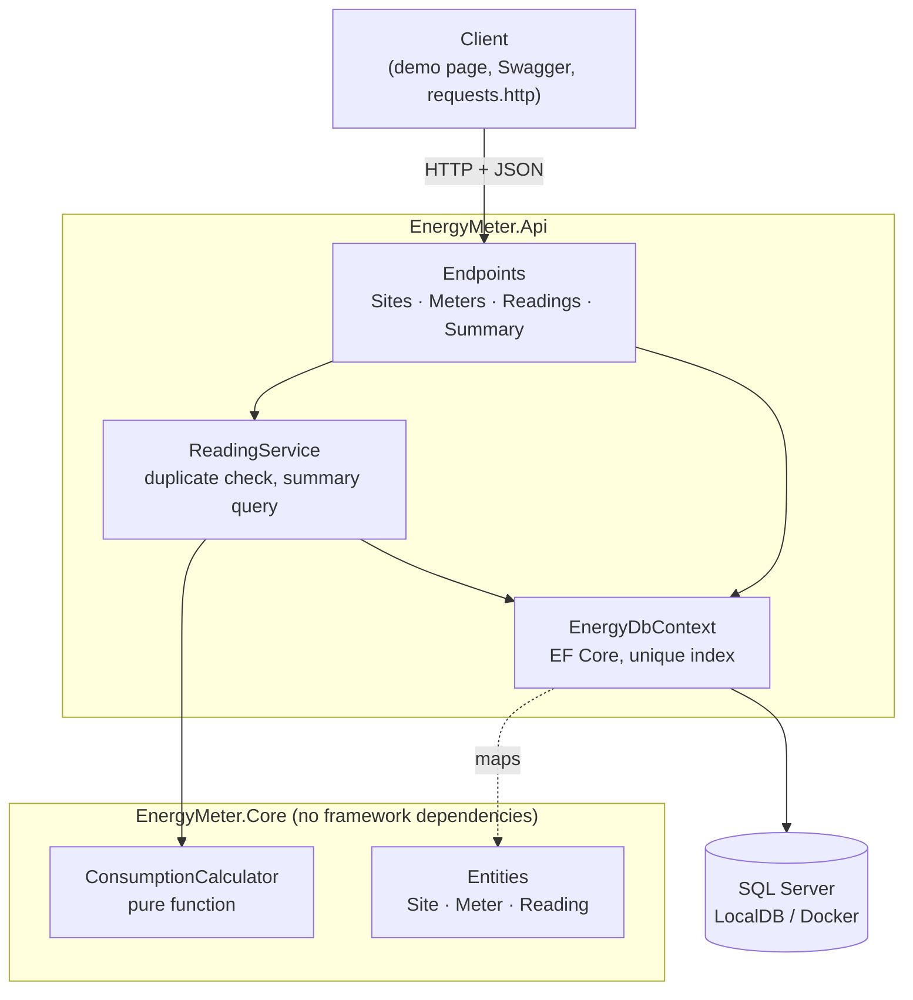
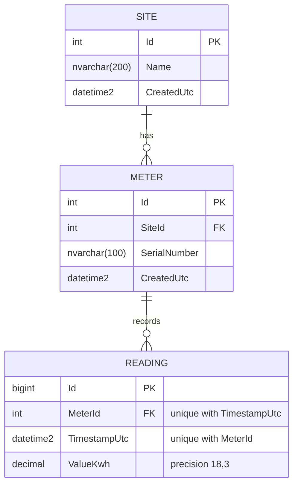
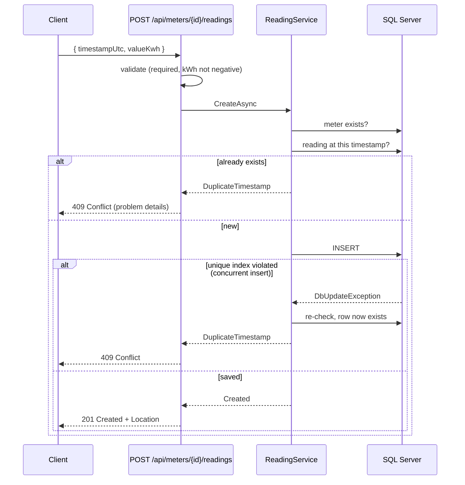
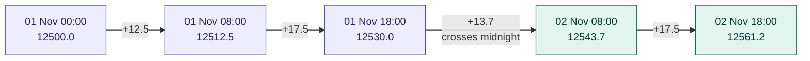

# Energy Meter Readings API

A .NET 8 Web API for capturing energy meter readings per site and querying consumption over a date range.
It uses ASP.NET Core minimal APIs, EF Core (code-first) on SQL Server, and xUnit.

Design notes and trade-offs are in [SOLUTION.md](SOLUTION.md).

## Prerequisites

- [.NET 8 SDK](https://dotnet.microsoft.com/download/dotnet/8.0)
- SQL Server. The default setup uses **SQL Server Express LocalDB** (`(localdb)\MSSQLLocalDB`).
  LocalDB is installed with Visual Studio's "ASP.NET and web development" or "Data storage" workloads,
  or [on its own](https://learn.microsoft.com/sql/database-engine/configure-windows/sql-server-express-localdb).
  If you're not on Windows, use the Docker option below.

## Run the API

```bash
dotnet run --project src/EnergyMeter.Api
```

Then open:
- **http://localhost:5080/**: a small demo page for browsing sites, meters and readings, adding data and charting the consumption summary;
- **http://localhost:5080/swagger**: interactive API docs.

The demo page is a single static HTML file ([`wwwroot/index.html`](src/EnergyMeter.Api/wwwroot/index.html)) with no build step. It only calls the public API, so it isn't part of the API itself. Times entered on the page are treated as UTC.

In the `Development` environment (the default launch profile), the app on startup:
1. applies the EF Core migration, which creates the `EnergyMeterReadings` database if it doesn't exist, and
2. seeds one demo site with one meter and five readings across 1–2 Nov 2026, so the summary endpoint has data straight away.

Both are controlled by `Database:ApplyMigrationsOnStartup` and `Database:SeedDemoData` in `appsettings*.json`.
They are off outside Development.

To apply the migration manually instead:

```bash
dotnet tool install --global dotnet-ef
dotnet ef database update --project src/EnergyMeter.Api
```

### Option: an installed SQL Server (e.g. Express)

If you already run SQL Server as a Windows service, point the API at it with user-secrets. They're stored in your profile, not in the repo, and are used by `dotnet run` and Visual Studio in the Development environment. For `dotnet ef`, add `-- --environment Development` so it reads them too:

```bash
dotnet user-secrets set "ConnectionStrings:EnergyDb" "Server=.\SQLEXPRESS;Database=EnergyMeterReadings;Trusted_Connection=True;TrustServerCertificate=True" --project src/EnergyMeter.Api
```

A service also avoids LocalDB's idle auto-shutdown. On some machines LocalDB can fail to restart for a while after shutting down, with "LocalDB instance startup: SQL Server process failed to start". If that happens, run `sqllocaldb stop MSSQLLocalDB -k` followed by `sqllocaldb start MSSQLLocalDB`, or use this option.

### Option: SQL Server in Docker

```bash
docker run -d --name energy-sql -e ACCEPT_EULA=Y -e MSSQL_SA_PASSWORD=Your_str0ng_Pass -p 1433:1433 mcr.microsoft.com/mssql/server:2022-latest
```

Point the API at it with an environment variable. The setting is read from configuration, so user-secrets also work.

```bash
export ConnectionStrings__EnergyDb="Server=localhost,1433;Database=EnergyMeterReadings;User Id=sa;Password=Your_str0ng_Pass;TrustServerCertificate=True"
dotnet run --project src/EnergyMeter.Api
```

(PowerShell: `$env:ConnectionStrings__EnergyDb = "..."`)

## Run the tests

```bash
dotnet test
```

The tests need no database:
- The consumption calculation tests are pure unit tests.
- The duplicate-reading tests and the HTTP endpoint tests use in-memory SQLite. SQLite is relational, so the unique index is really enforced.

## API

All timestamps are UTC ISO 8601 (`2026-11-01T08:00:00Z`). Input with an offset (`+02:00`) is converted to UTC.
Input with no zone is treated as UTC. Readings are cumulative kWh values.

| Method | Route | Description |
|---|---|---|
| `POST` | `/api/sites` | Create a site |
| `GET` | `/api/sites` | List sites |
| `GET` | `/api/sites/{siteId}` | Get a site |
| `POST` | `/api/sites/{siteId}/meters` | Create a meter on a site |
| `GET` | `/api/sites/{siteId}/meters` | List a site's meters |
| `GET` | `/api/meters/{meterId}` | Get a meter |
| `POST` | `/api/meters/{meterId}/readings` | Add a reading (`409` if the timestamp already exists for the meter) |
| `GET` | `/api/meters/{meterId}/readings?fromUtc=&toUtc=` | List readings, optionally filtered (inclusive) |
| `GET` | `/api/meters/{meterId}/readings/{readingId}` | Get a reading |
| `GET` | `/api/meters/{meterId}/summary?fromUtc=&toUtc=` | Consumption summary (both parameters required) |

[`src/EnergyMeter.Api/requests.http`](src/EnergyMeter.Api/requests.http) contains every request below and can be run from VS Code or Visual Studio.

### Examples

**Create a site**

```http
POST /api/sites
{ "name": "Johannesburg Warehouse" }
```
```json
201 Created
Location: /api/sites/2
{ "id": 2, "name": "Johannesburg Warehouse", "createdUtc": "2026-11-15T12:00:00Z" }
```

**Create a meter**

```http
POST /api/sites/2/meters
{ "serialNumber": "MTR-0002" }
```
```json
201 Created
{ "id": 2, "siteId": 2, "serialNumber": "MTR-0002", "createdUtc": "2026-11-15T12:00:05Z" }
```

**Add a reading**

```http
POST /api/meters/1/readings
{ "timestampUtc": "2026-11-03T08:00:00Z", "valueKwh": 12580.4 }
```
```json
201 Created
{ "id": 6, "meterId": 1, "timestampUtc": "2026-11-03T08:00:00Z", "valueKwh": 12580.4 }
```

**Duplicate timestamp**

```json
409 Conflict
{
  "type": "https://tools.ietf.org/html/rfc9110#section-15.5.10",
  "title": "Duplicate reading timestamp",
  "status": 409,
  "detail": "Meter 1 already has a reading at 2026-11-03T08:00:00Z."
}
```

**Summary** (seeded data)

```http
GET /api/meters/1/summary?fromUtc=2026-11-01T00:00:00Z&toUtc=2026-11-02T23:59:59Z
```
```json
{
  "meterId": 1,
  "fromUtc": "2026-11-01T00:00:00Z",
  "toUtc": "2026-11-02T23:59:59Z",
  "readingCount": 5,
  "totalConsumptionKwh": 61.200,
  "daily": [
    { "date": "2026-11-01", "consumptionKwh": 30.000 },
    { "date": "2026-11-02", "consumptionKwh": 31.200 }
  ],
  "hasDecreasingReadings": false
}
```

**Validation error**

```json
400 Bad Request
{
  "title": "One or more validation errors occurred.",
  "status": 400,
  "errors": {
    "timestampUtc": ["timestampUtc is required (ISO 8601 UTC, e.g. 2026-11-01T08:00:00Z)."],
    "valueKwh": ["valueKwh is a cumulative register value and cannot be negative."]
  }
}
```

Errors are returned as RFC 7807 `application/problem+json`: `400` for validation or binding failures, `404` for unknown sites, meters or readings, and `409` for duplicate timestamps.

## Project layout

```
src/
  EnergyMeter.Core/      Entities, UTC helper, ConsumptionCalculator (no framework dependencies)
  EnergyMeter.Api/       Minimal API endpoints, contracts, EF Core DbContext + migration, ReadingService, demo page
tests/
  EnergyMeter.Tests/     Calculator unit tests, duplicate-rule tests (SQLite), HTTP endpoint tests
```

## Diagrams

### Architecture



### Data model



### Adding a reading (duplicate rule)



### Summary calculation

Using the seeded readings, each difference is attributed to the UTC date of the **later** reading:



| | 2026-11-01 | 2026-11-02 | Total (last − first) |
|---|---|---|---|
| kWh | 12.5 + 17.5 = **30.0** | 13.7 + 17.5 = **31.2** | 12561.2 − 12500.0 = **61.2** |
